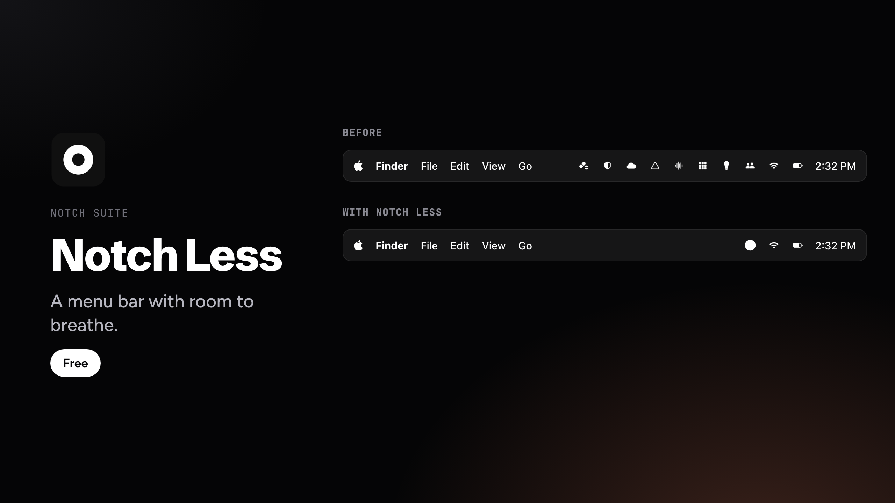

# Notch Less



A menu bar with room to breathe. The icons you choose tuck behind a single disc; the clock, battery and Wi-Fi stay, the rest comes back with a click. Free.

## Install

1. Download the DMG from the [latest release](../../releases/latest) and drag the app to Applications.
2. The app is not notarized by Apple. If macOS blocks the first launch, go to System Settings › Privacy & Security and click **Open Anyway**.

macOS 13 or later, Apple silicon or Intel.

## Build from source

```bash
NotchLess/build.sh
```

Requires the Xcode Command Line Tools. All rights reserved: no open source license is granted.

Part of Notch Suite: [Notch Island](https://github.com/eprysmn/notch-island), [Notch Bar](https://github.com/eprysmn/notch-bar) and [Notch Less](https://github.com/eprysmn/notch-less). Also on [Gumroad](https://eprysmn.gumroad.com).
